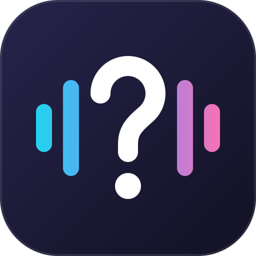
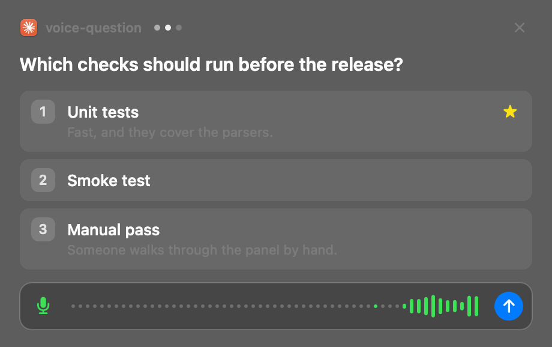

<p align="center">
  
</p>

<h1 align="center">VoiceQuestion</h1>

<p align="center">
  <strong>Hear your AI agent's question. Answer it out loud.</strong><br>
  A macOS menu bar app that reads an agent's question to you and sends back what you say, with Wispr Flow doing the dictation.
</p>

---

When an AI agent stops to ask you something (`AskUserQuestion`), VoiceQuestion **reads the question aloud, turns on Wispr Flow dictation, turns it off when you stop talking, and passes what you said back as the answer to that question.**

## How it works

| | Step | How |
|---|---|---|
| 1 | The agent asks a question | A Claude Code hook, or a log watcher for ChatGPT and Aside |
| 2 | The question is read aloud | Your choice of offline macOS speech or online neural TTS, with a panel at the top of the screen |
| 3 | The microphone turns on | `wispr-flow://start-hands-free` |
| 4 | You answer, and the end of your speech is detected | Microphone input level (voice activity detection) |
| 5 | The microphone turns off | `wispr-flow://stop-hands-free` |
| 6 | Your answer reaches the agent | The hook's response, or the clipboard |

- Wispr Flow still does the dictation, so your dictionary and style settings apply. VoiceQuestion only starts and stops it in place of the fn key.
- If anything fails, or you skip, you always get the app's **own question dialog** back. VoiceQuestion never makes up an answer.

## Requirements

- macOS 14 or later, with a Swift toolchain (Xcode or the Command Line Tools)
- [Wispr Flow](https://wisprflow.ai), running. Without it the panel still appears, but voice input is skipped.

## Install

```sh
git clone https://github.com/cloneisjun/voice-question.git
cd voice-question
./scripts/install.sh
```

`install.sh` does three things:

1. Builds a release and installs it as `~/Applications/VoiceQuestion.app`
2. Registers a login item (LaunchAgent `com.cloneisjun.voicequestion`) and starts the app
3. Adds the Claude Code hook to `~/.claude/settings.json` (the existing file is backed up as `*.voicequestion.bak`)

Options: `--no-hooks`, `--no-login-item`, `--settings FILE` (also add the hook to another Claude Code settings file), `--codex-hook` (experimental Codex hook).

When macOS asks for microphone access after the install, click **Allow**. VoiceQuestion only measures the input level to notice when you have finished speaking; it does not record or store audio. It also works without the permission, but then you press Return when you finish speaking. If you do not press Return within 45 seconds, it goes ahead with whatever has been transcribed so far, or skips if there is nothing.

> Claude Code sessions that are already open do not pick up the hook. Start a new session.

A handy alias:

```sh
alias vq="$HOME/Applications/VoiceQuestion.app/Contents/MacOS/VoiceQuestion"
```

## Try it

| # | Try this | Expected result |
|---|---|---|
| 1 | `vq doctor` | App running, Wispr Flow running, microphone permission granted, Claude Code hook installed |
| 2 | Menu bar icon → **Ask a test question** (or `vq test`), then say "Pasta" ("파스타") | You hear the question, Wispr Flow starts, it stops about 1.6 seconds after you stop talking, and after a 2-second confirmation an "Answer: Pasta" message appears |
| 3 | Same question, say "the second one" or "number two" ("두 번째", "2번") | The second option is selected |
| 4 | Same question, say "skip" ("건너뛰기") | A "Skipped" message (with a real agent, its own question dialog appears) |
| 5 | Press Esc during the 2-second confirmation, edit the text, then press Return | The edited text is delivered as the answer. ⌘R lets you speak again |
| 6 | `vq ask --question "Deploy now?" --option Yes --option No --json` | The answer is printed as JSON (exit code 0 answered, 2 skipped) |
| 7 | In a new Claude Code session: "Use the AskUserQuestion tool to ask me my favorite color" | The voice panel appears in place of Claude Code's question dialog, and Claude carries on with the answer you spoke |
| 8 | Menu → **Pause**, then repeat 7 | Claude Code's own question dialog appears |
| 9 | Have ChatGPT desktop (Codex) ask a question | You hear the question, the answer is copied to the clipboard, and the thread opens. Press ⌘V in the question card |
| 10 | The flow without any sound: `vq ask --question "Color?" --option Red --option Blue --simulate "the second one"` | "Blue", with no audio |
| 11 | `vq ask --question "Toppings?" --option Cheese --option Basil --option Olives --multi --json`, then click **Basil** | `Basil` is sent at once. Run it again, ⌘-click **Cheese** and **Olives**, then press Return: `Cheese, Olives` |

Menu and panel text follow the system language: Korean when Korean is your first preferred language, English otherwise. On a Korean system the menu items above read 테스트 질문 실행 (Ask a test question) and 일시 중지 (Pause). The voice follows the language of each question. The sample question is in Korean (김치찌개 / 파스타 / 샐러드) whenever Korean appears anywhere in your preferred languages, otherwise in English (Sushi / Pasta / Salad).

### The panel

<p align="center">
  
</p>

The only text on the panel is the question itself. Everything else is a symbol:

| On the panel | Meaning |
|---|---|
| App icon and name, top left | Who is asking, with the session or project name when it is known |
| Dots next to the name | One per question in this request; the bright one is the current question |
| ✕ | Skip: go back to the app's own question dialog |
| Number on a card | ⌘ and that number answers with the option. It turns into a check mark when the option is chosen |
| ★ on a card | The option the agent recommends (its label ends in "(Recommended)") |
| Speaker | The question is being read |
| Microphone and moving bars | Listening. The bars follow the microphone level and turn green once your voice is heard |
| Three dots | Transcribing |
| Ring around ↑ | Your answer is sent when the ring is gone (`autoSendDelaySeconds`). Return sends it now; Esc or a click in the text stops the ring so you can edit |
| ↺ | Speak again (⌘R) |
| Crossed-out microphone and a line of text | Voice input is not available right now; click an option or type |
| ↑ | Send (Return) |

Hover over a symbol to see its name.

**One click on an option sends it as the answer.** That holds for questions that allow several options too; there is no extra Send step. Click anywhere on the card, including its number, title or description. To choose several options with the mouse, ⌘-click (or ⇧-click) each one, then press ↑ or Return; by voice, say them together ("one and three"). A typed answer is sent with ↑ or Return.

### What you can say

- An option's name, its position ("the first one", "number two", "the last one"), or several at once when the question allows it ("one and three")
- A free-form answer that is not one of the options. It is passed along as is.
- "skip", "pass" or "cancel" to go back to the app's own question dialog, and "again" to be heard once more

The same works in Korean: "두 번째", "2번", "마지막", "1번이랑 3번", "건너뛰기", "다시".

### Panel shortcuts

Return send · Shift-Return new line · Esc edit during the countdown, otherwise skip · ⌘R speak again · ⌘1…⌘9 answer with an option · ⌘-click or ⇧-click choose several options

## App support

| App | Detecting the question | Delivering the answer | Status |
|---|---|---|---|
| **Claude Code** (CLI, SDK, IDE) | `PreToolUse` hook (`AskUserQuestion`) | The hook returns the answer, so Claude continues without showing its dialog | Supported |
| **Claude desktop: Code tab** | Same hook (`~/.claude/settings.json`) | Same | Expected to work, not verified |
| **Claude desktop: Chat / Cowork** | No way | No way | Not supported |
| **ChatGPT desktop (Codex)** | Session log watcher (`request_user_input`) | Copies the answer to the clipboard and opens the thread; you press ⌘V | Reading and dictation are automatic, pasting is manual. Not yet verified with a live question |
| **Aside** | Daemon log watcher | Copies the answer to the clipboard; you press ⌘V | Reading and dictation are automatic, pasting is manual. Not yet verified with a live question |
| **Clone** | Claude Code hook (its own settings folder) | The hook returns the answer | Add it yourself with `--settings` |

More detail lives in three documents:

- [docs/app-support.md](docs/app-support.md): how each app is detected and answered, and the limits
- [docs/verification.md](docs/verification.md): what has been verified and what has not
- [docs/similar-projects.md](docs/similar-projects.md): similar open-source projects

## Question voices

Choose **Question voice** in the menu bar:

| Engine | What it uses | Network / setup |
|---|---|---|
| **On this Mac · Offline** (default) | The best installed macOS voice for the question's language | No network or extra dependency. Enhanced/Premium voices sound better than the compact voices supplied with macOS. |
| **Neural voice · Microsoft online** | Microsoft Edge neural voices through the optional [edge-tts](https://github.com/rany2/edge-tts) client | Internet required; question text is sent to Microsoft. No API key or paid account is needed by this client. |

Online voices are optional. Install their runtime once (Python 3.9+ is required), then select the engine:

```sh
./scripts/setup-neural-tts.sh
vq tts use edge
vq tts preview --language ko  # speech only: no panel, microphone or Wispr Flow
vq tts preview --language en
vq tts preview --language ko --voice ko-KR-HyunsuMultilingualNeural  # try another voice without saving
vq tts use system            # switch back to offline speech
```

The same preview is available as **Question voice → Preview voice only**. It is unavailable during a question, and a new question stops a menu preview. Engine changes apply from the next question. The app never switches a local user to an online engine automatically.

Korean defaults to `ko-KR-SunHiNeural`, English to `en-US-EmmaMultilingualNeural`. To customize online voices, add this to your settings (merge it with your other settings):

```json
{
  "tts": {
    "engine": "edge",
    "voices": { "ko": "ko-KR-SunHiNeural", "en": "en-US-EmmaMultilingualNeural" },
    "timeoutSeconds": 15
  }
}
```

Other Korean choices include `ko-KR-InJoonNeural` and `ko-KR-HyunsuMultilingualNeural`; `en-US-JennyNeural` is another English choice. List current voice names with `"$HOME/Library/Application Support/VoiceQuestion/tts-venv/bin/python3" -m edge_tts --list-voices`. Online voice names go in `tts.voices`; macOS identifiers stay in the separate top-level `voices` map. An optional `tts.pythonPath` can point to your own Python environment.

Korean option numbers are spoken as `일 번`, `이 번`, `삼 번` so TTS engines do not interpret them as repetition counts (`한 번`, `두 번`, `세 번`). Visible numbers and the answer labels sent back to the agent are unchanged. A different voice is a listening preference; neural synthesis alone does not guarantee natural-sounding Korean.

If online synthesis fails, times out, or has no configured voice for the question's language, the question uses the offline macOS voice. Cancelling or answering a question stops synthesis and playback. Generated audio lives in a private temporary directory and is removed after playback or cancellation. For a sample you want to keep, `vq tts preview --language ko --output sample.mp3` exports without playing audio or opening a microphone; existing files are never overwritten.

`edge-tts` is a third-party LGPL-3.0 client, installed separately in a user virtual environment; this is not an official Azure Speech integration and availability may change. The Swift app still builds and runs offline without it. Provider code is isolated in `NeuralSpeechRenderer.swift` and `Speaker.swift`, so other cloud or local engines can be added without changing question detection, dictation or answer delivery.

## Settings

`~/Library/Application Support/VoiceQuestion/config.json` (menu → **Open settings file**). Every key is optional, and a saved change applies from the next question.

```json
{
  "micStart": "auto",
  "speakQuestions": true,
  "speakOptions": true,
  "speechRate": 1.0,
  "speechVolume": 1.0,
  "autoSendDelaySeconds": 2.0,
  "vad": { "endSilenceSeconds": 1.6, "noSpeechTimeoutSeconds": 12 },
  "codex": { "enabled": true, "deliver": "clipboard" },
  "aside": { "enabled": true, "deliver": "clipboard" }
}
```

| Key | Default | Description |
|---|---|---|
| `enabled` | `true` | When off, the hook does nothing (the same as Pause in the menu) |
| `micStart` | `auto` | `auto`: with headphones the microphone opens together with the question, with speakers it opens once the question has been read. `immediately` or `afterSpeech` pins one behavior |
| `speakQuestions` | `true` | When off, there is no sound, only the panel and the microphone |
| `speakOptions`, `speakOptionDescriptions` | `true`, `false` | Also read the options, and their descriptions |
| `speechRate`, `speechVolume` | `1.0` | Speaking rate multiplier, and volume (0 to 1) |
| `tts.engine` | `system` | `system`: offline macOS voices. `edge`: optional online neural voices. Also selectable in the menu or with `vq tts use` |
| `tts.voices`, `tts.timeoutSeconds`, `tts.pythonPath` | Korean SunHi / English Emma, `15`, managed venv | Online voice names, synthesis timeout, optional Python interpreter. See Question voices above |
| `voices` | `{}` | A voice per language, for example `{"ko": "com.apple.voice.premium.ko-KR.Yuna"}` |
| `autoSendDelaySeconds` | `2.0` | Time to review the transcribed answer before it is sent. `0` sends right away |
| `retriesOnEmpty` | `1` | How many times to listen again when nothing was recognized |
| `skipWhenMicBusy` | `true` | Skip while another app (a call, a recording) is using the microphone |
| `focus` | `onAnswer` | `onAnswer`: the panel takes the keyboard only just before your answer arrives. `immediately`: as soon as the question appears |
| `panelActivation` | `nonactivating` | Set to `activate` if the transcribed text does not land in the panel |
| `vad.endSilenceSeconds` | `1.6` | This much silence means the answer is finished |
| `vad.noSpeechTimeoutSeconds` | `12` | Skip when nothing is said for this long |
| `vad.maxAnswerSeconds` | `90` | Longest answer |
| `vad.enabled`, `vad.device`, `vad.speechThresholdDb`, `vad.noiseMarginDb` | `true`, `auto`, automatic, `10` | Fine-tuning for end-of-speech detection (check the levels with `vq miccheck`) |
| `wispr.transcriptTimeoutSeconds` | `12` | How long to wait for the transcript after the microphone is turned off |
| `codex.deliver` | `clipboard` | `clipboard` / `paste` (also presses ⌘V and Return for you; experimental, needs the Accessibility permission) / `none` (read aloud only) |
| `aside.deliver` | `clipboard` | `clipboard` / `resume` or `steer` (delivers through the `aside` CLI; experimental) / `none` |

Environment variables: `VQ_DISABLE=1` (turn the hook off), `VQ_SIMULATE_TRANSCRIPT=text` (answer with this text, without audio), `VQ_LOG_TRANSCRIPTS=1` (write transcripts to the log), `VQ_SOCKET` / `VQ_CONFIG` / `VQ_LOG` (a separate instance for testing).

## Troubleshooting

- **Checking the state**: `vq doctor` and `vq status`. The log is at `~/Library/Logs/VoiceQuestion/voicequestion.log` (menu → **Open log**)
- **macOS asks for the microphone again after a rebuild**: the app is signed ad hoc, without a certificate. If the prompt does not appear, run `tccutil reset Microphone com.cloneisjun.VoiceQuestion`, then choose **Request microphone access…** in the menu. If you have a signing certificate, use `CODESIGN_IDENTITY="Apple Development: …" ./scripts/install.sh`
- **It cuts you off too early, or waits too long**: adjust `vad.endSilenceSeconds`
- **A noisy room hides the end of your speech**: look at the levels with `vq miccheck` and pin `vad.speechThresholdDb`, or press Return when you finish
- **The transcript lands in the app you were using, not in the panel**: set `"panelActivation": "activate"` or `"focus": "immediately"`
- **On speakers, the spoken question leaks into the dictation**: with the default (`micStart: auto`) the microphone opens only after the question when you are on speakers. If you changed it to `immediately`, change it back
- **Wispr Flow is not running**: only the panel appears, and it skips after 45 seconds (use the app's own question dialog)
- **Nothing happens in Claude Code**: check that you started a new session, run `vq hooks status`, and make sure the app is running. When the app is not running, the hook quietly steps aside and the usual question dialog appears

## Privacy

- Microphone: only the input level (dB) is computed. Audio is never recorded, stored or sent anywhere. Wispr Flow does the dictation.
- Wispr Flow history (`flow.sqlite`): read-only, and only to look up the dictation you just made when its paste did not reach the panel.
- By default the log does not contain what you said, only its length in characters.
- Offline TTS (the default) makes no network requests. The app and hooks communicate over a local Unix socket.
- Opting into online TTS sends the text being read (the question and any enabled options/descriptions) to Microsoft. VoiceQuestion does not send microphone audio or your dictated answer to the TTS service. Wispr Flow handles dictation under its own settings.

## Uninstall

```sh
./scripts/uninstall.sh          # removes the app, the login item and the hooks
./scripts/uninstall.sh --purge  # also the settings, the logs and the microphone permission
```

## Development

```sh
./scripts/test.sh        # core logic, and the panel driven by synthetic clicks (no window, no audio)
./scripts/build.sh       # build/VoiceQuestion.app
./scripts/make-icon.sh   # Resources/AppIcon.icns, after changing the logo
```

`VQ_SNAPSHOT_DIR=DIR ./scripts/test.sh` also draws every state of the panel offscreen and saves it as a PNG in `DIR`, which is how `docs/assets/panel.png` is made (the blur behind the panel is not part of that picture).

```
Sources/VQCore/         Logic without AppKit: models, IPC, answer matching, end-of-speech detection, hook and log parsers
Sources/VoiceQuestion/  Menu bar app and CLI: panel, session state machine, TTS, Wispr control, log watchers, delivery
Tests/VQCoreTests/      Unit tests
Tests/VQUITests/        The panel and a session behind it: clicks, states, drawing (never on screen, no microphone)
Resources/              Info.plist and the app icon (AppIcon.icns, generated from the logo)
scripts/                build / install / uninstall / test / make-icon
docs/assets/            Logo (logo.svg is the source, logo.png is a 512 px render) and the panel picture
```

A single executable is both the menu bar app and the CLI. The hook (`VoiceQuestion hook claude`) passes the question to the running app over a Unix socket, waits for the answer, and prints it as JSON that Claude Code understands. If the app is not running, or you skip, it prints nothing and exits, so the agent shows its own question dialog.
